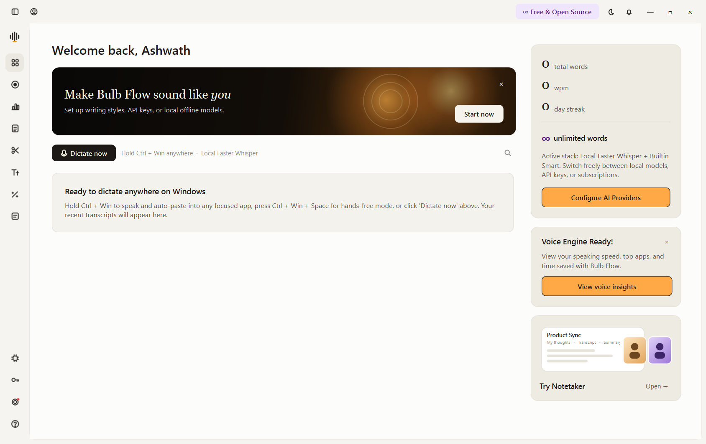

# Bulb Flow

> **Free, open-source AI voice dictation and meeting notetaker for Windows — with zero word limits.**
> Speak naturally in any app and get clean, context-aware, style-matched text pasted straight at your cursor using **100% free local models**, **your own API keys**, or **your existing AI subscriptions**.



---

## Why Bulb Flow?

Most AI voice-typing apps lock unlimited dictation behind recurring monthly subscriptions and force your audio through proprietary servers. **Bulb Flow** puts you completely in control:

- **Unlimited Words, Forever Free** — No weekly caps, no accounts required, MIT open-source.
- **Works Everywhere on Windows** — Hold **`Ctrl + Win`** (Push-to-Talk) or press **`Ctrl + Win + Space`** (Hands-Free) inside any app (Slack, Gmail, WhatsApp, VS Code, Notion, Word, browsers) to dictate and auto-paste without polluting your Windows Clipboard History (`Win + V`).
- **Floating Waveform Pill** — A sleek, always-on-top dictation bar docked subtly at the bottom of your screen that expands with a live waveform when you speak.
- **Bring Your Own AI Stack**:
  - **100% Free & Offline Local Models**: Local `Faster-Whisper` speech recognition + instant built-in smart cleanup, **Ollama**, **llama.cpp**, or **LM Studio**.
  - **Bring Your Own API Keys**: **Groq** (ultra-fast free tier with Whisper-v3-Turbo & Llama 3.3), **Google Gemini** (free tier native audio + text), **OpenAI**, **Anthropic Claude**, **Deepgram Nova-3**, and **OpenRouter**.
  - **Use Your Existing Subscriptions**: Route AI cleanup & transforms through installed **Claude Code (`claude`)**, **OpenAI Codex (`codex`)**, or **Gemini (`gemini`)** CLIs, or any OpenAI-compatible local proxy (LiteLLM / Copilot proxy).
- **Context-Aware Writing Styles** — Automatically detects your active app (Personal messages, Work messages, Email, Code & IDE, Other) and applies your chosen tone (`Formal.`, `Casual`, `very casual`, `Excited!`) and Auto-Cleanup level (`None`, `Light`, `Medium`).
- **Personal Dictionary & Voice Snippets** — Teach Bulb Flow names, acronyms, and custom auto-replacements, plus spoken triggers that expand into full links, templates, or sign-offs.
- **AI Transforms, Scratchpad Notes & Meeting Notetaker** — Rewrite or summarize text with reusable prompts, capture quick voice notes, and record meetings with AI-generated summaries and action items.
- **Privacy First** — Your transcripts, notes, dictionary, snippets, and API keys stay strictly in a local SQLite database on your machine.

---

## Installation Guide (Windows)

### Prerequisites
- **Windows 10 or Windows 11**
- **Python 3.10 – 3.12** — Download from [python.org/downloads](https://www.python.org/downloads/) *(important: check **"Add python.exe to PATH"** during installation)*.

### Option 1: One-Click Setup (Easiest)
1. Click the green **`Code`** button at the top of this page → **`Download ZIP`** (or clone with Git).
2. Extract the folder anywhere on your PC (for example, `C:\Users\YourName\bulb-flow`).
3. Double-click **`run_bulb_flow.bat`**.
   - On first launch, it automatically creates a clean virtual environment, installs dependencies, and opens Bulb Flow.
   - On future launches, it starts immediately.

### Option 2: Command Line Setup
```powershell
git clone https://github.com/webstriker-lab/bulb-flow.git
cd bulb-flow
python -m venv .venv
.\.venv\Scripts\activate
pip install -r requirements.txt
python main.py
```

---

## Choosing Your AI Backend (2-Minute Setup)

Open **AI Providers** (bottom-left sidebar icon or the **`∞ Free & Open Source`** pill in the top-right bar) and pick any combination:

| Mode | Speech-to-Text (STT) | AI Polish & Style | Cost |
| :--- | :--- | :--- | :--- |
| **100% Offline & Private** *(default)* | Local Faster-Whisper (`base` / `small` / `large-v3-turbo`) | Built-in Smart Local Cleanup or **Ollama** / **llama.cpp** | **Free** |
| **Fastest Cloud Free Tier** | **Groq** (`whisper-large-v3-turbo`) | **Groq** (`llama-3.3-70b-versatile`) | **Free tier** |
| **Google Free Tier** | **Google Gemini** (`gemini-2.5-flash` native audio) | **Google Gemini** (`gemini-2.5-flash`) | **Free tier** |
| **Frontier BYOK** | **OpenAI** (`gpt-4o-mini-transcribe`) or **Deepgram** (`nova-3`) | **OpenAI**, **Anthropic Claude**, or **OpenRouter** | Pay-as-you-go API |
| **Existing Subscriptions** | Local Faster-Whisper | **Claude CLI**, **Codex CLI**, **Gemini CLI**, or Custom Proxy | Included in your plan |

> **Tip for Local Models**: On your very first offline dictation, `Faster-Whisper` automatically downloads your chosen model size (e.g. `base` is ~145 MB) once and caches it locally so every future dictation works completely offline.

---

## Default Shortcuts & Tips

| Action | Default Shortcut | Notes |
| :--- | :--- | :--- |
| **Push-to-Talk** | Hold **`Ctrl + Win`** | Speak while holding, release to transcribe & auto-paste |
| **Hands-Free Dictation** | Press **`Ctrl + Win + Space`** | Press once to start, press again to stop & paste |
| **Spoken Self-Correction** | Say **`"scratch that"`** | Automatically replaces the previous phrase |
| **Toggle Dark / Light Mode** | Moon / Sun icon (top right) | Switches between warm parchment light & obsidian dark themes |

All shortcuts, microphones, auto-paste behavior, and floating pill visibility can be customized anytime in **Settings**.

---

## Privacy & Data Storage

- All settings, history, dictionary words, snippets, notes, meetings, and API keys are stored locally in `%APPDATA%\BulbFlow\bulb_flow.sqlite`.
- Temporary dictation pastes automatically tag Windows clipboard privacy formats (`ExcludeClipboardContentFromMonitorProcessing`, `CanIncludeInClipboardHistory`, `CanUploadToCloudClipboard`) and verify the clipboard sequence number before restoring your previous clipboard.
- Export all your data anytime as JSON from **Settings → Export All Data**.

---

## License

Licensed under the [MIT License](LICENSE).
